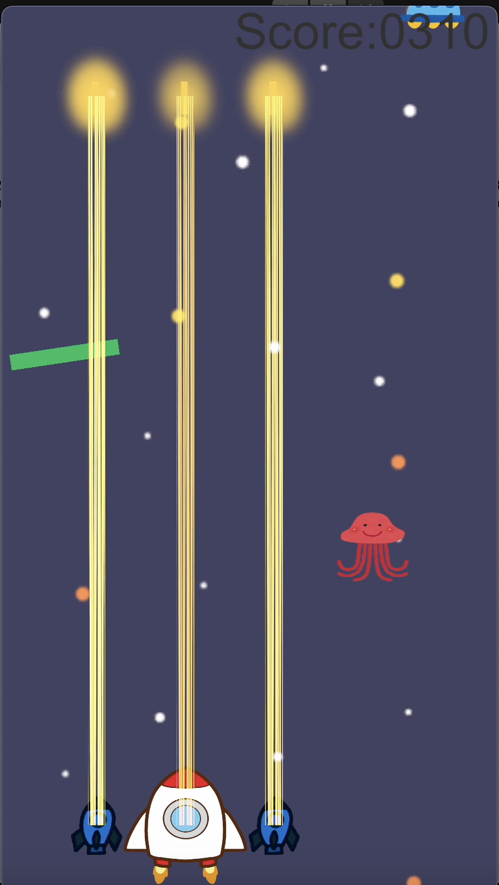

# 🚀 2D Space Shooting Game

Unityで作成した2D縦スクロールシューティングゲームです。

## ゲーム概要

ロケットを操作して宇宙空間を飛ぶ隕石を破壊し、スコアを稼ぐゲームです。  
スコアが **1000点** に達するとゲームクリアです。

## 画面構成

| 画面 | 説明 |
|------|------|
| タイトル画面 | スタート・マニュアル・終了ボタン |
| ゲーム画面 | メインゲームプレイ |
| ゲームオーバー画面 | リスタート・タイトルボタン |
| ゲームクリア画面 | リスタート・タイトルボタン |
| マニュアル画面 | 操作説明 |

## 操作方法

| キー | 操作 |
|------|------|
| ← → キー | ロケットを左右に移動 |
| Space | 弾を発射 |

## アイテム

| アイテム | 色 | 効果 |
|----------|-----|------|
| スコアアップ | 🟢 緑 | スコア +30点 |
| サブロケット | 🔴 赤 | 左右にサブロケットを追加（最大2機） |
| 拡散ショット | 🟡 黄 | 10秒間、3方向に弾を発射 |

## スコアシステム

- 隕石破壊: **+10点**
- 緑アイテム取得: **+30点**
- 1000点達成: **ゲームクリア**
- スコアが上がるにつれて隕石の出現が速くなる

## 技術仕様

- **エンジン**: Unity 6000.3.10f1
- **言語**: C#
- **視点**: 2D縦スクロール
- **入力**: キーボード

## 参考

- [UnityでSTGを作る](https://nn-hokuson.hatenablog.com/entry/2016/07/04/213231)

## スクリーンショット

